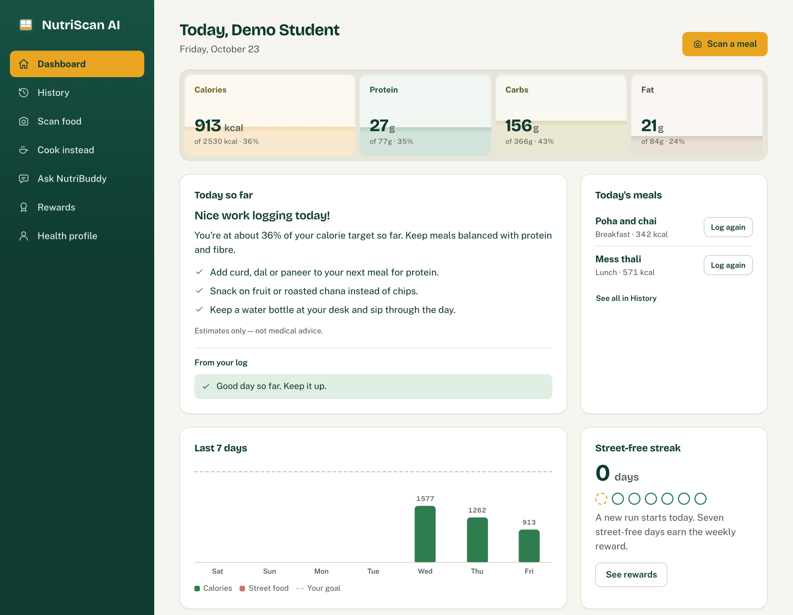

# NutriScan AI

NutriScan AI helps students in hostels and shared flats understand what they eat. Photograph a plate and it
identifies every item on it, estimates grams, calories and eight nutrients per item and per plate, and returns
a health score from 0 to 100 with flags ("High in salt for one meal") and budget-friendly tips. A chatbot,
NutriBuddy, answers food questions from text and photos, knows the user's profile and today's intake, and can
read their data or log a meal for them.

The project is a FastAPI backend (REST and SSE under `/api/v1`) with a small web app served at `/app/`.

> *Estimates only — not medical advice.*



## Features

- Scan a meal photo to get items, portions, nutrients, plate totals, a health score, flags and tips. Items
  and grams can be edited afterwards, and totals and score are recomputed.
- Chat with NutriBuddy in text or with photos. Replies stream over SSE, and function calling lets it read
  intake data or log a meal.
- Track intake: daily totals against personal targets, N-day summaries, and logging by description
  ("2 roti, dal and lassi").
- Get a daily insight and recipe ideas that respect diet type (veg, eggetarian, non-veg, vegan), allergies
  and kitchen (none, kettle or burner).
- Try it as a guest without signing up, or run the whole API in mock mode (`MOCK_AI=true`) with no Gemini key
  or model download.

The backend computes every number it can (plate totals, daily totals, targets, health score) in Python, and
takes nutrients from a curated foods table (IFCT 2017 / USDA) where the dish is known. Gemini supplies
per-item estimates and the wording of tips only.

## Tech stack

| Layer | Technology |
|---|---|
| API | Python 3.11+, FastAPI, Pydantic v2, Uvicorn |
| Database | SQLAlchemy 2.0 (async) and Alembic; PostgreSQL (`asyncpg`) or SQLite (`aiosqlite`) |
| AI | Gemini via `google-genai`: vision, structured JSON, function calling, streaming |
| Image classifier | [`nateraw/food`](https://huggingface.co/nateraw/food), a ViT fine-tuned on Food-101 (CPU) |
| Web app | Plain HTML, CSS and JavaScript, no build step |
| Tooling | pytest, ruff, Docker |

## Architecture

```
 web app (/app/) or any client
        │  HTTPS · bearer token · JSON envelope or SSE
        ▼
┌──────────────────────────────── FastAPI process ────────────────────────────────┐
│                                                                                 │
│  /api/v1 routes ─► services: scans · intake · chat · insights · recipes · users │
│                                                                                 │
│  Scan:  photo ─► validate, resize, strip EXIF ─► ViT classifier (top-k hints)   │
│               ─► Gemini vision (items, grams, nutrients, tips)                  │
│               ─► foods-table lookup ─► totals + health score (Python)           │
│                                                                                 │
│  Chat:  profile, targets, today's intake, linked scan ─► Gemini with tools      │
│               ◄─► get_daily_intake, log_meal, … (this user's data only)         │
│                                                                                 │
│  All Gemini calls: app/services/llm/gemini_client.py (fallback model, retries)  │
│  Background: alert watchdog, guest cleanup, upload sweep, classifier loading    │
└───────────┬─────────────────────────────┬───────────────────────────┬───────────┘
            ▼                             ▼                           ▼
  PostgreSQL or SQLite            photo storage (local disk,       Gemini API
  users, scans, intake,           signed expiring URLs)
  chat, foods
```

CPU-bound work (image resizing, classifier inference) runs in a thread pool. The classifier is the
transfer-learning component; Food-101 is single-label and Western-heavy, so its predictions are only hints and
Gemini decides what is on the plate.

## Getting started

### Local

```bash
python3.11 -m venv .venv && source .venv/bin/activate
pip install torch --index-url https://download.pytorch.org/whl/cpu   # CPU-only PyTorch
pip install -r requirements.txt
cp .env.example .env        # set GEMINI_API_KEY and JWT_SECRET (or MOCK_AI=true)
python scripts/smoke_gemini.py   # optional: checks the key and model names
alembic upgrade head
python scripts/seed_demo.py      # optional: demo@nutriscan.app / demo12345 with 3 days of meals
uvicorn app.main:app --reload
```

Open http://localhost:8000/app/ for the web app and http://localhost:8000/docs for the API reference. The
first start downloads the ~350 MB classifier in the background; scans work without classifier hints until
`/api/v1/health` reports it as `loaded`.

In mock mode every endpoint returns deterministic fixtures, which is what the tests and frontend work use.

### PostgreSQL

The same code runs on PostgreSQL and SQLite; only `DATABASE_URL` changes. Set it in `.env`:

```bash
# local or self-hosted PostgreSQL
DATABASE_URL=postgresql+asyncpg://nutriscan:<password>@localhost:5432/nutriscan
# Supabase: the session pooler URI from Project Settings → Database (plain postgresql:// is converted)
DATABASE_URL=postgresql://postgres.<ref>:<password>@aws-0-<region>.pooler.supabase.com:5432/postgres
```

Then create the empty database, run `alembic upgrade head` and start the server. The foods table is seeded on
first start. TLS is used automatically for remote hosts (Supabase is verified against
`certs/supabase-ca.crt`) and skipped for `localhost`. Pick a database region close to the server, since every
query pays the round trip.

### Docker (API + PostgreSQL 16 + backups)

```bash
cp .env.example .env              # set GEMINI_API_KEY, JWT_SECRET and POSTGRES_PASSWORD
docker compose up --build         # API on :8000; runs alembic upgrade head on start
docker compose exec api python scripts/seed_demo.py   # optional demo data
```

The PostgreSQL container has no published port, so only the API can reach it. Backups are covered in
[Backups and recovery](#backups-and-recovery).

## Configuration

All settings come from environment variables or `.env`; [`.env.example`](.env.example) lists every one with
comments. The ones you will usually touch:

| Variable | Default | Notes |
|---|---|---|
| `APP_ENV` | `dev` | `prod` refuses to start with a weak `JWT_SECRET` or `MOCK_AI=true` |
| `DATABASE_URL` | `sqlite+aiosqlite:///./nutriscan.db` | See [PostgreSQL](#postgresql) |
| `JWT_SECRET` | | At least 32 random characters in production |
| `GEMINI_API_KEY` | | From [Google AI Studio](https://aistudio.google.com/apikey) |
| `GEMINI_MODEL` / `GEMINI_FALLBACK_MODEL` | `gemini-3.8-flash` / `gemini-3.5-flash-lite` | The fallback is used on timeouts, 429s and 5xx |
| `MOCK_AI` | `false` | `true` = fixtures instead of Gemini and the classifier |
| `CLASSIFIER_MODEL_ID` | `nateraw/food` | Hugging Face id or a local fine-tuned model |
| `PUBLIC_BASE_URL` | `http://localhost:8000` | Public URL, used to build photo links |
| `CORS_ORIGINS` | `*` | Set the frontend origin(s) in production |
| `METRICS_TOKEN` / `ALERT_WEBHOOK_URL` | | Enable `/metrics` and Slack/Discord alerts |

## API

Every route is under `/api/v1` and returns the same envelope; errors use it too, with `success: false`,
`data: null` and optional `details`:

```json
{ "success": true, "code": "SCAN_CREATED", "message": "…", "data": { } }
```

| Area | Endpoints |
|---|---|
| System | `GET /health` · `GET /health/ready` · `GET /meta` (nutrient keys, units, enums) |
| Auth | `POST /auth/register` · `POST /auth/login` · `POST /auth/guest` |
| Users | `GET /users/me` · `PUT /users/me/profile` · `GET /users/me/targets` |
| Scans | `POST /scans` · `GET /scans` · `GET/DELETE /scans/{id}` · `PATCH /scans/{id}/items` · `POST /scans/{id}/tips` · `POST /scans/{id}/log` |
| Intake | `POST /intake/describe` · `POST /intake` · `GET /intake` · `GET /intake/daily` · `GET /intake/summary` · `DELETE /intake/{id}` |
| Insights, recipes | `GET /insights/daily` · `POST /recipes/suggest` |
| Chat | `POST/GET /chat/sessions` · `GET/PATCH/DELETE /chat/sessions/{id}` · `POST /chat/sessions/{id}/messages[/stream]` · `GET /chat/suggestions` |
| Media | `GET /media/{path}?exp=&sig=` (photos via signed, expiring URLs only) |

Nutrients always use the keys `calories`, `protein_g`, `carbohydrates_g`, `fat_g`, `saturated_fat_g`,
`fiber_g`, `sugar_g` and `sodium_mg`. The exported schema is [`docs/openapi.json`](docs/openapi.json), and
example payloads for every endpoint are in [`docs/examples/`](docs/examples).

## Health score and targets

- Daily targets use the Mifflin-St Jeor BMR × an activity factor, −400 kcal to lose or +300 to gain, and never
  go below 1,200 kcal or the BMR. Without a complete profile, a 2,000 kcal default is used.
- Each meal is scored 0 to 100 against its share of the day (breakfast 25 %, lunch 35 %, dinner 30 %,
  snack 10 %). Points come off for sodium, sugar, saturated fat, calories and fat above that share, and for
  protein and fibre below it. 75+ is good, 50 to 74 moderate, below 50 needs attention.

## Production deployment

The Docker image is the deployable unit (Cloud Run, Render, Fly.io or a VM). On start it runs
`alembic upgrade head`, then Uvicorn on port 8000. Before going live:

1. Set `APP_ENV=prod`, a new `JWT_SECRET`, a PostgreSQL `DATABASE_URL`, an `https://` `PUBLIC_BASE_URL`,
   explicit `CORS_ORIGINS`, and `FORWARDED_ALLOW_IPS` for your reverse proxy. Start-up logs a warning for
   each risky value it finds.
2. Run a single instance with one worker: rate limits and the insight cache are kept in memory.
3. Mount a persistent volume at `/data` for photos and the model cache.
4. Back up the database before deploying a release that adds a migration.

Guest accounts and their photos are deleted after `GUEST_RETENTION_DAYS` (3). In production, photos that no
scan or message references are swept on the same schedule. Elsewhere, `python scripts/sweep_uploads.py` lists
them and `--delete` removes them; run it only against the database the photos belong to, because against any
other database every photo looks unreferenced.

## Monitoring

Monitoring is built in and needs no extra services (code in `app/core/metrics.py` and
`app/services/monitoring.py`):

- Logs are JSON lines on stdout with a request id and user id, never emails, passwords, tokens or meal text.
- `GET /metrics` serves Prometheus metrics (requests, latency, error codes, Gemini calls and tokens, jobs)
  when called with `Authorization: Bearer $METRICS_TOKEN`.
- A watchdog checks every minute and posts to `ALERT_WEBHOOK_URL` (Slack or Discord) when the database is
  down, 5xx errors or Gemini failures spike, requests get slow, a background job fails, or disk or memory
  run low. It sends a `RESOLVED` message when the problem clears.
- Point an external uptime monitor at `GET /api/v1/health/ready`, which answers 503 when the database is
  down. It catches what the process can't report itself: a crash, a dead host or broken TLS.
- Set a budget alert on the Gemini key in Google Cloud; the metrics count tokens but not spend.

## Backups and recovery

With Docker Compose, the `backup` service dumps the database every 24 hours, proves each dump restores into
a scratch database, archives the photos, and keeps 14 days in `./backups`. That folder sits on the same disk
as the database, so copy it elsewhere too (for example `rclone sync ./backups remote:nutriscan-backups`).

Restore (replaces all data in one transaction; a failed restore changes nothing):

```bash
docker compose stop api
docker compose run --rm -e CONFIRM=yes backup sh /backup/restore.sh /backups/db-<STAMP>.dump
docker compose run --rm -T api sh -c 'tar -xzf - -C /data' < backups/uploads-<STAMP>.tar.gz   # photos
docker compose start api
```

On Supabase, backups depend on your plan, and the free plan has none you can rely on. Schedule
`pg_dump "$DATABASE_URL" -Fc -f nutriscan.dump` yourself, and back up the `/data` volume separately.

## Fine-tuning the classifier

`ml/finetune_indian_food.py` starts from `nateraw/food`, replaces the 101-class head with Indian dishes and
fine-tunes it on a GPU (Colab or Kaggle, about 20 to 40 minutes on a T4):

The dataset must be in ImageFolder layout, `ml/data/indian_food/<class_name>/*.jpg`, for example the Kaggle
"Indian Food Images" dataset (80 classes):

```bash
kaggle datasets download -d iamsouravbanerjee/indian-food-images-dataset -p ml/data --unzip
pip install -r requirements.txt torchvision datasets accelerate
python ml/finetune_indian_food.py --data-dir ml/data/indian_food --food101-classes 20
```

Then set `CLASSIFIER_MODEL_ID=ml/output/indian-food-vit` and restart.

## Testing

```bash
ruff check .
pytest -q                        # mock mode, a fresh SQLite database per test, no network
RUN_LIVE=1 pytest -q -m live     # optional: real Gemini calls (needs GEMINI_API_KEY)
```

If an AI endpoint returns `503 AI_UNAVAILABLE`, `details.reason` says why (`auth`, `quota`, `model`,
`network`, `timeout`). `python scripts/smoke_gemini.py` diagnoses key and model problems.
